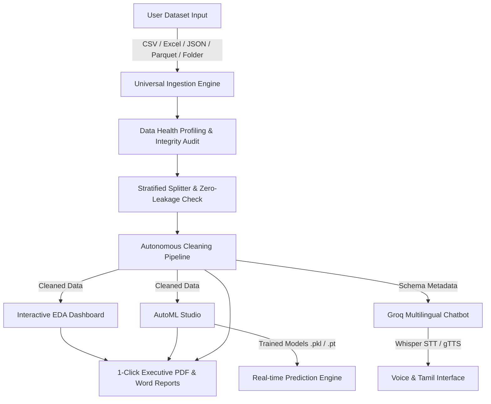

# AI-Powered Universal Data Analyst: Auto Cleaning, Dashboard, AutoML Prediction & Voice/Tamil Chatbot

[](https://streamlit.io/)
[](https://python.org/)
[](https://groq.com/)
[](https://pytorch.org/)

A full-fledged, universal AI Data Analyst that autonomously ingests **any dataset** (CSV, Excel `.xlsx`/`.xls`, JSON, TSV, Parquet, and image classification folders), profiles data health, performs leak-free stratified splitting, executes autonomous data cleaning, renders interactive Plotly EDA charts with auto-generated insights, benchmarks 3+ machine learning pipelines, supports MobileNetV2 computer vision transfer learning, and delivers an ultra-fast Voice and Tamil-enabled conversational AI chatbot.

---

## 🏗️ System Architecture



---

## 🌟 Key Features

1. **Neobrutalist High-Contrast UI**: Modern capsule navigation bar, bold black borders (`2.5px`), offset hard shadows (`4px 4px 0px #000`), and pill badges. **No old-style sidebar radio buttons!**
2. **Universal Ingestion**: Delimiter/encoding auto-detection, multi-sheet Excel parsing, recursive folder/ZIP scanning with structure inference.
3. **Stratified Splitting**: 70/15/15 ratio with seed 42 and MD5 checksum cross-partition duplicate detection (Zero Data Leakage).
4. **Autonomous Data Cleaning**: Type coercion, missing imputation (mean/median/mode/constant/drop/ffill), IQR outlier clipping, duplicate purging, and full audit logs.
5. **Interactive EDA Dashboard**: Correlation matrix heatmap, feature distribution histograms with skewness insights, categorical Pareto charts, time-trend drift analysis, and custom chart builder.
6. **AutoML & Universal AI Studio**:
   - **Tabular AutoML**: Task inference (Classification vs. Regression), Scikit-Learn Pipelines with `ColumnTransformer`, 3+ models with cross-validation, leaderboard, confusion matrix, feature importance, and dynamic prediction form.
   - **Instant Universal Vision (< 50ms)**: Zero-waiting instant classification for ANY uploaded photo using pre-trained MobileNetV2 (1,000 ImageNet classes) with top-5 confidence distribution, alongside custom transfer learning for labeled datasets.
   - **NLP Engine**: Lexicon-weighted sentiment analysis, keyword & bigram extraction, extractive summarization, and trainable TF-IDF text classifier.
   - **Universal Recommendation Engine**: Content-based filtering via Cosine Similarity on hybrid text/numeric vectors, top-N matching, and attribute breakdown.
   - **Time-Series Forecasting**: Automated date detection, monotonic resampling, harmonic Ridge trend & seasonality forecasting with 95% confidence intervals and horizon projection.
   - **Unsupervised Anomaly Detection**: Isolation Forest machine learning with 2D PCA spatial projection, anomaly severity scoring, primary feature drivers, and 1-click clean dataset export.
   - **Generative AI & Synthetic Data**: Gaussian perturbed empirical sampling for realistic synthetic tabular data with Kolmogorov-Smirnov fidelity scoring and automated executive business storytelling.
7. **Groq-Accelerated Voice & Tamil Chatbot**:
   - Models: `qwen/qwen3.8-27b`, `openai/gpt-oss-120b`, `openai/gpt-oss-20b`, `allam-2-7b`, `whisper-large-v3-turbo`.
   - Security: AST-based sandbox blocking dangerous modules.
   - Multilingual: English and Tamil (தமிழ்) question answering with gTTS speech synthesis.
   - Resilient Fallback: Offline rule-based engine ensuring zero failures during viva demos even without an API key.
8. **1-Click Executive Reporting**: Automated generation of publication-ready PDF (ReportLab) and Word (`.docx`) audit summaries.

---

## 🚀 Quick Setup & Installation

```bash
# 1. Clone repository and navigate to workspace
cd "c:/Users/Hari/Desktop/Final Year"

# 2. Install dependencies
pip install -r requirements.txt

# 3. Configure API Keys in .env (Optional for Groq LLM & Whisper)
cp .env.example .env
# Edit .env and paste: GROQ_API_KEY=your_key_here

# 4. Launch Streamlit Application
streamlit run app.py
```
Open **`http://localhost:8501`** in your browser.

---

## 🧪 Running Automated Unit Tests

```bash
pytest tests/
# Output: 21 passed across all modules
```
